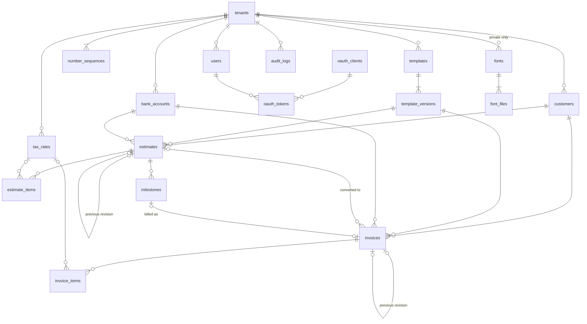

# Data Model (Phase 1) — Revised

The original ER in the requirements PDF was reviewed and corrected. This file is now the source of truth for the schema; the PDF diagram is superseded. Every change and the reason for it is listed in **§6 Change log**.

**18 tables.** The PDF says 17, but its own diagram has 18; 18 is correct and no tables were added.

---

## 1. Conventions

| Topic | Rule |
|-------|------|
| Primary keys | `id UUID` (UUIDv7, generated in Go). Time-ordered, safe to expose in URLs, no sequence leaks between tenants. Exception: `audit_logs.id BIGINT GENERATED ALWAYS AS IDENTITY`. |
| Money | `NUMERIC(14,2)`. Never `float`/`money`. |
| Quantity | `NUMERIC(12,3)` (hours, days, fractional units). |
| Rates / percents | `NUMERIC(6,3)` holding a percentage (`18.000` = 18%). |
| Currency | `CHAR(3)` ISO 4217, default `'LKR'`. |
| Text case-insensitive | `email` columns use `citext`. |
| Timestamps | `TIMESTAMPTZ NOT NULL DEFAULT now()`. Every mutable table has `created_at` and `updated_at`. |
| Enums | Postgres `CHECK (col IN (…))` on `text`, not `CREATE TYPE`, so adding values later needs no enum migration. |
| Deletes | `ON DELETE RESTRICT` by default. Customers and templates are **archived** (`archived_at`), never deleted, once a document references them. |
| Tenant FKs | Every FK to a tenant-owned parent is **composite**: `(tenant_id, x_id) → parent(tenant_id, id)`. Every tenant-owned parent therefore has `UNIQUE (tenant_id, id)`. |

## 2. Tables

### 2.1 Tenant and configuration

**`tenants`**
| Column | Type | Notes |
|--------|------|-------|
| id | uuid PK | |
| name | text NOT NULL | Business name |
| legal_name | text | If different from trading name |
| reg_no | text | Company registration number |
| tax_reg_no | text | **VAT / TIN, required on Sri Lankan tax invoices** |
| address | text | |
| phone, email | text, citext | Shown on documents |
| logo_path | text | R2 key |
| currency | char(3) NOT NULL DEFAULT 'LKR' | Default for new documents |
| default_terms | text | Copied into new estimates and invoices |
| default_validity_days | int NOT NULL DEFAULT 30 | Used for estimate `valid_until` |
| created_at, updated_at | timestamptz | |

**`tax_rates`**: id, tenant_id, name (`'VAT'`, `'SSCL'`), rate numeric(6,3) `CHECK (rate >= 0)`, is_default bool, active bool, created_at, updated_at.
- `UNIQUE (tenant_id, name)`
- `UNIQUE (tenant_id) WHERE is_default`: at most one default.

**`bank_accounts`**: id, tenant_id, account_name, account_number, bank, branch, swift, is_default, active, created_at, updated_at.
- `UNIQUE (tenant_id) WHERE is_default`

**`number_sequences`**
| Column | Type | Notes |
|--------|------|-------|
| tenant_id | uuid | PK part |
| doc_type | text `CHECK IN ('estimate','invoice')` | PK part |
| prefix | text | e.g. `INV` |
| format | text | e.g. `{prefix}-{yyyy}-{seq:4}` → `INV-2026-0001` |
| reset_policy | text `CHECK IN ('never','yearly')` | |
| current_period | int | Year the counter belongs to; reset when the issue year differs |
| next_value | int NOT NULL DEFAULT 1 | |

PK `(tenant_id, doc_type)`. The row is taken with `SELECT … FOR UPDATE` **inside the finalise transaction**.

**`users`**: id, tenant_id, email citext, password_hash, role `CHECK IN ('owner')`, last_login_at, created_at, updated_at.
- `UNIQUE (email)` is **global**: at login the tenant is not known yet, so the email must resolve to exactly one user.

### 2.2 Auth (OAuth 2.1 / Fosite)

**`oauth_clients`** (global, no tenant)
| Column | Notes |
|--------|-------|
| id uuid PK | |
| client_id text UNIQUE | |
| client_secret_hash text NULL | NULL = public client (PKCE only) |
| name | e.g. "Claude", "ChatGPT" |
| redirect_uris text[] NOT NULL | Exact-match validation |
| grant_types text[], response_types text[], scopes text[] | |
| token_endpoint_auth_method text | `none` for public clients |
| registered_via text `CHECK IN ('dynamic','manual')` | |
| created_at, last_used_at | Prune unused dynamic registrations |

**`oauth_tokens`**: one table for every Fosite artefact
| Column | Notes |
|--------|-------|
| id uuid PK | |
| kind text `CHECK IN ('authorization_code','access_token','refresh_token','pkce')` | |
| signature_hash text NOT NULL | SHA-256 of the token signature; raw tokens are never stored |
| request_id text NOT NULL | Fosite request ID. Revoking it revokes the whole grant chain |
| client_id uuid FK → oauth_clients | |
| tenant_id uuid, user_id uuid | Composite FK `(tenant_id, user_id) → users` |
| scopes text[], granted_audience text[] | |
| session_data jsonb | Fosite session (includes the PKCE challenge) |
| expires_at, used_at, revoked_at, created_at | `used_at` marks a consumed auth code; reuse triggers chain revocation |

- `UNIQUE (kind, signature_hash)`, `INDEX (request_id)`, `INDEX (expires_at)` for a cleanup job.

### 2.3 Customers

**`customers`**: id, tenant_id, name NOT NULL, company, phone, email citext, address, **tax_reg_no** (buyer's VAT number, needed on B2B tax invoices), notes, archived_at, created_at, updated_at.
- Search: `pg_trgm` GIN index on `name`, `company`, `email`, `phone`. The AI's "find customer" is fuzzy.
- No unique key on name. Duplicates are handled in the service (`find` before `create`) plus the idempotency key in §4.

### 2.4 Templates and fonts

**`templates`**: id, tenant_id, name, doc_type `CHECK IN ('estimate','invoice')`, current_version_id, is_default, archived_at, created_at, updated_at.
- `UNIQUE (tenant_id, doc_type) WHERE is_default`
- `UNIQUE (tenant_id, id, doc_type)`: target for the doc-type-safe FK below.
- FK `(tenant_id, current_version_id) → template_versions(tenant_id, id)` `DEFERRABLE INITIALLY DEFERRED` (circular reference).

**`template_versions`** (append-only): id, **tenant_id**, template_id, **doc_type**, version int, typst_source text, sample_data jsonb, created_by_user_id, created_via `CHECK IN ('web','ai')`, created_at.
- FK `(tenant_id, template_id, doc_type) → templates(tenant_id, id, doc_type)`: a version always has its template's type.
- `UNIQUE (template_id, version)`, `UNIQUE (tenant_id, id, doc_type)`.
- Restoring an old version means copying it into a new version, never editing in place.

**`fonts`**: id, family, tenant_id NULL (= shared library), source `CHECK IN ('google','upload','other')`, licence, created_at.
- `UNIQUE (family) WHERE tenant_id IS NULL` and `UNIQUE (tenant_id, family) WHERE tenant_id IS NOT NULL`.
- RLS: `tenant_id IS NULL OR tenant_id = current_tenant`. Shared rows are read-only to the app role.

**`font_files`**: id, font_id, **tenant_id NULL** (copied from the font for RLS), weight int, style `CHECK IN ('normal','italic')`, file_path, created_at.
- `UNIQUE (font_id, weight, style)`.

### 2.5 Estimates

**`estimates`**
| Column | Notes |
|--------|-------|
| id, tenant_id | |
| customer_id | FK `(tenant_id, customer_id)` |
| template_version_id, doc_type `'estimate'` | FK `(tenant_id, template_version_id, doc_type) → template_versions`. An invoice template can't be used here. |
| bank_account_id NULL | Which account to print |
| number text NULL | **NULL while Draft**, assigned at finalise |
| revision int NOT NULL DEFAULT 0 | |
| previous_revision_id NULL | FK to the row this revision replaces |
| status `CHECK IN ('draft','final','superseded')` | `sent/accepted` added later |
| title | |
| currency char(3) | Copied from the tenant at creation |
| issue_date, valid_until | `CHECK (valid_until >= issue_date)` |
| terms | Editable on Draft, frozen on Final |
| subtotal, discount_total, tax_total, total | numeric(14,2), NULL on Draft, **written once at finalise** |
| customer_snapshot jsonb, issuer_snapshot jsonb | Frozen at finalise (see §3) |
| pdf_path, pdf_sha256 | Set at finalise |
| finalised_at, finalised_by | |
| created_at, updated_at | |

- `UNIQUE (tenant_id, number, revision)`
- `UNIQUE (tenant_id, id, customer_id)`: target for the invoice consistency FK.
- `CHECK (status = 'draft') = (number IS NULL)`
- `CHECK (status = 'draft' OR (total IS NOT NULL AND pdf_path IS NOT NULL AND finalised_at IS NOT NULL))`

**`estimate_items`**
| Column | Notes |
|--------|-------|
| id, tenant_id, estimate_id | FK `(tenant_id, estimate_id)` ON DELETE CASCADE (only Drafts can be edited) |
| sort_order int | `UNIQUE (estimate_id, sort_order) DEFERRABLE` |
| description text NOT NULL | |
| quantity numeric(12,3) `CHECK (> 0)` | |
| unit_price numeric(14,2) `CHECK (>= 0)` | |
| discount_type `CHECK IN ('none','percent','amount')`, discount_value numeric(14,2) | |
| tax_rate_id NULL | FK `(tenant_id, tax_rate_id)` |
| tax_name, tax_rate | Snapshot at finalise, e.g. `'VAT'`, `18.000` |
| line_total numeric(14,2) | Snapshot at finalise (after discount, before tax) |
| is_addon bool NOT NULL DEFAULT false | Excluded from `subtotal/tax_total/total` |

**`milestones`**
| Column | Notes |
|--------|-------|
| id, tenant_id, estimate_id | FK `(tenant_id, estimate_id)` ON DELETE CASCADE |
| sort_order | |
| name, note | |
| percent numeric(6,3) | `CHECK (percent > 0 AND percent <= 100)` |
| due_date NULL | Can be unknown at estimate time |
| invoice_id NULL | FK `(tenant_id, invoice_id) → invoices`; `UNIQUE (invoice_id)` so one invoice per milestone |

- The amount is derived: `round(percent / 100 × estimates.total, 2)`. The **last** milestone takes the rounding remainder so the amounts add up to the total exactly.
- Σ percent = 100 is checked by the finalise service and by a `CONSTRAINT TRIGGER … DEFERRABLE INITIALLY DEFERRED` on milestones of non-draft estimates.

### 2.6 Invoices

**`invoices`**: same shape as `estimates`, with these differences:
| Column | Notes |
|--------|-------|
| estimate_id NULL | FK `(tenant_id, estimate_id, customer_id) → estimates(tenant_id, id, customer_id)`. **Enforces the customer-consistency rule in the DB.** With `MATCH SIMPLE`, a NULL `estimate_id` skips the check. |
| doc_type `'invoice'` | Template FK as for estimates |
| issue_date, due_date | `CHECK (due_date >= issue_date)` |
| status `CHECK IN ('draft','final','superseded')` | `sent/paid/void` added later |
| no `valid_until` | |

**`invoice_items`**: same as `estimate_items` without `is_addon`. Add-ons the client accepts become ordinary lines when an estimate is converted.

### 2.7 Audit

**`audit_logs`** (append-only)
| Column | Notes |
|--------|-------|
| id bigint identity PK | |
| tenant_id | |
| user_id NULL | NULL for system jobs |
| via `CHECK IN ('web','ai','system')` | |
| oauth_client_id NULL | Which AI client acted (Claude, ChatGPT…) |
| request_id text | Correlates with logs and the MCP call |
| action, entity, entity_id | |
| changes jsonb | Before and after diff |
| created_at | |

- The app role has `INSERT, SELECT` only, with no UPDATE or DELETE.
- `INDEX (tenant_id, entity, entity_id)`, `INDEX (tenant_id, created_at DESC)`. Partition by month if it grows.

## 3. Document lifecycle rules

1. **Draft**: `number`, totals, snapshots and PDF are NULL. Draft items can be changed freely. Totals are computed live for previews.
2. **Finalise** (one transaction): validate (items exist, Σ milestones = 100) → lock the `number_sequences` row → assign `number` → write line snapshots (`tax_name`, `tax_rate`, `line_total`) → write header totals, `customer_snapshot` (name, company, address, tax_reg_no), `issuer_snapshot` (tenant name, address, reg/tax numbers, logo key, chosen bank account) → render the PDF → upload it to R2 → store `pdf_path` and `pdf_sha256` → set `status='final'`. If the render fails, everything rolls back and **no number is consumed**, so numbering has no gaps (needed for tax invoices).
3. **Final rows are immutable.** A `BEFORE UPDATE` trigger rejects changes to any non-draft row except `status → 'superseded'`. The same applies to items and milestones of non-draft parents (except `milestones.invoice_id`).
4. **Revision**: copy the final row and its children into a new Draft row with `revision + 1` and `previous_revision_id` set. It keeps the same `number`, assigned at its own finalise without consuming the sequence. On finalise, the previous row becomes `superseded`. An estimate whose milestones are already invoiced cannot be revised.
5. **Convert**: only a `final` estimate can be converted. Either one invoice copies all non-addon items (plus any add-ons the owner accepts), or one invoice per milestone with a single line `"<milestone name> – <percent>% of <estimate number>"`, setting `milestones.invoice_id`.

## 4. Supporting rules

- **RLS**: every tenant table has `ENABLE` and `FORCE ROW LEVEL SECURITY` with the policy `tenant_id = current_setting('app.tenant_id')::uuid`. The app connects as a non-owner role and sets `SET LOCAL app.tenant_id` per transaction.
- **Auth tables are outside RLS.** `users` lookup by email at login, and all of `oauth_clients` and `oauth_tokens`, run before a tenant is known. Implementation: they use the same app role but are queried only by `internal/auth` (a separate DB role was judged not worth a second pool on the shared VPS; revisit when roles/multi-user arrive).
- **Implementation additions:** `tenants.default_payment_days` (invoice due date default), `notes` on documents, `fonts.source` adds `bundled`.
- **Preview links** are stateless HMAC-signed tokens (`doc id + revision + expiry`), so no table is needed. Rotating the signing key revokes them all.
- **Idempotency** (recommended, not counted in the 18): AI clients retry tool calls. Add `idempotency_keys (tenant_id, key, response jsonb, created_at)` if duplicate customers or estimates show up in testing.

## 5. Relationships

## 6. Change log (original ER → revised)

| # | Problem in the original ER | Impact | Fix |
|---|---------------------------|--------|-----|
| 1 | `template_versions` had no `tenant_id` | Composite FKs from documents couldn't be tenant-checked. Breaks RLS and the stated "every table carries tenant_id" rule. | Added `tenant_id` and composite FKs. |
| 2 | `font_files` had no `tenant_id` | Private font files of one tenant readable through RLS gaps | Added nullable `tenant_id` mirroring `fonts`. |
| 3 | Plain `customer_id`, `template_version_id`, `tax_rate_id`, `invoice_id` FKs | A document could point at another tenant's customer, template, tax rate or invoice | All tenant FKs made composite `(tenant_id, x_id)`. |
| 4 | Invoice ↔ estimate customer match stated as a rule only | App bug could mismatch | Enforced with composite FK `(tenant_id, estimate_id, customer_id)`. |
| 5 | Nothing stopped an invoice template being used for an estimate | Broken PDFs | `doc_type` carried into the template-version FK. |
| 6 | `number` assigned with no rule on when | Drafts would burn numbers and leave gaps in the tax-invoice sequence | Number NULL on Draft, assigned in the finalise transaction; render failure rolls back. |
| 7 | `revision` column with no model for how revisions are stored | Unclear whether issued docs get overwritten | Revision = new row, same number, `previous_revision_id`, old row `superseded`. `UNIQUE (tenant_id, number, revision)`. |
| 8 | Snapshots covered totals, terms and tax_rate only | Changing a customer's address or the tenant's bank account would change re-rendered issued docs | Added `customer_snapshot`, `issuer_snapshot`, `bank_account_id`, item `tax_name`, `line_total`, document `currency`. |
| 9 | No tax registration numbers | Sri Lankan VAT invoices must show supplier **and** buyer VAT numbers | `tenants.tax_reg_no`, `customers.tax_reg_no`. |
| 10 | `discount` undefined (percent or amount?) | Ambiguous totals | `discount_type` + `discount_value`; `discount_total` on header. |
| 11 | `oauth_tokens` couldn't hold auth codes or PKCE sessions, and had no request chain | Fosite can't be implemented. No refresh-token reuse detection. | `kind`, `signature_hash`, `request_id`, `session_data`, `used_at`. Client secret, grant types and auth method added to `oauth_clients`. |
| 12 | `users` and `oauth_*` under tenant RLS | Login and token lookup happen before tenant is known, so they deadlock with RLS | Auth tables excluded from RLS and accessed via a dedicated `auth` role. `users.email` globally unique. |
| 13 | `is_default` flags unconstrained | Two default tax rates, banks or templates | Partial unique indexes. |
| 14 | `templates.current_version_id` ↔ `template_versions.template_id` cycle | Can't insert either row first | Current-version FK `DEFERRABLE INITIALLY DEFERRED`. |
| 15 | `number_sequences` had no yearly reset | `INV-2027-0001` impossible | `reset_policy`, `current_period`. |
| 16 | `invoices` had no `issue_date` or `title` | Invoice date unknowable | Added. |
| 17 | Milestone amount rounding unspecified | 3 × 33.333% doesn't add up to the total | The last milestone takes the remainder. `due_date` nullable. `percent` range check. One invoice per milestone (`UNIQUE invoice_id`). |
| 18 | No status, money or quantity types or checks | Floats, negative prices, free-text statuses | Types and CHECKs in §1–2. |
| 19 | No `updated_at`, `archived_at`, `finalised_at/by` | Can't delete referenced customers. No accountability for issuing. | Added. RESTRICT deletes with archiving. |
| 20 | `audit_logs` couldn't say which AI acted, and was mutable | Weak audit trail | `oauth_client_id`, `request_id`, `via` adds `system`, append-only grants. |
| 21 | Immutability of Final documents was a rule only | App bug could edit issued docs | `BEFORE UPDATE` triggers on documents, items and milestones. |
| 22 | Table count "17" | Doc inconsistency | Corrected to 18. |

## 7. Deliberately not changed

- **One tax per line item.** Sri Lankan stacked taxes (SSCL charged, then VAT on value + SSCL) don't fit this model. If the owner's invoices need SSCL, add `estimate_item_taxes` and `invoice_item_taxes` (item_id, tax_rate_id, rate, sequence, compound) before go-live. Left as an open question because it changes the totals engine.
- **Credit notes and voiding issued invoices** are deferred to Phase 3 (payments). Until then, issued invoices are corrected by revision.
